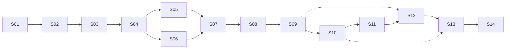

<!-- TOC -->

# 闸 · TimeGate — GitHub 发布项目制 SOP（最终版）

**版本** v1.0 Final · **状态** 已确认 · **更新** 2026-11-09<br>
**适用范围** 从「Web demo + 已冻结的原生需求」推进到 GitHub `v1.0.0` 发布。<br>
**当前基线** Web demo 已完成；原生代码 0 行；仓库未初始化；未发布 GitHub。<br>
**决策** 4 项已确认（2026-11-09），见 §0.1。

---

## 0. 怎么用这份 SOP

这份 SOP 不是排期表，是**交接协议**。每个工包（S01–S14）都可以交给一个独立 agent 单独完成，前提是它只读文件、不依赖聊天记录。

四条规则：

1. **一个工包 = 一次独立任务**。开始前只读本 SOP 对应章节 + 该工包的输入清单；结束后必须写 `docs/handoff/SXX.md`。
2. **输入必须是文件**。上一工包的交付物落在仓库里，下一工包从仓库读，不从对话里猜。
3. **一个路径只有一个主人**。只改自己 ownership（§6）内的文件；共享文件（Gradle、Manifest、CI）由 S04 统一改，其他工包提变更请求。
4. **三道门禁**：
   - **G1 需求冻结**（S02 结束）：需求基线签字，之后新增走变更记录。
   - **G2 质量门禁**（S12 结束）：P0 全过、真机自检全过、无 INTERNET、无密钥泄漏。
   - **G3 发布批准**（S14 前）：必须由项目负责人明确说「可以发」，才允许推送仓库、打 tag、建 Release。

### 0.1 已确认决策（2026-11-09）

| 项 | 决定 | 影响 |
|---|---|---|
| 包名 / 应用名 | `com.timegate.app` /「闸」 | 仓库名 `timegate`，APK 的 `applicationId` 固定 |
| minSdk | 26（Android 8.0） | 覆盖更广；代码需兼容 API 26 |
| 无障碍 | V1 纳入，作为**可选增强**；不给只撤遮挡 | 「退出即回桌面」不是必需能力 |
| 专注时长 | V1 只做 25 分钟；到时页保留 10 分钟短专注 | 不做 45 / 60 分钟档 |

这四项不再讨论；S01 只负责把它们写成 ADR 与冻结版。

### 0.2 术语表

| 术语 | 含义 | 不要写成 |
|---|---|---|
| 工包 | 一个可独立交接的任务单元（S01–S14） | 任务、阶段 |
| 闸门 | 打开受管应用前的三步：时长 → 意图 → 替代 | 弹窗、拦截页 |
| 受管应用 | 被纳入监控与拦截的应用 | 目标 App、限制应用 |
| 到时 | 承诺时长归零的时刻；界面标题为「时间到」 | 超时、结束 |
| 门禁 | 必须满足才能进入下一阶段的检查点（G0–G3） | 检查、验收 |
| 走查 | 按验收步骤在真机上人工执行 | 测试（泛指） |
| Integrator | 共享文件的唯一修改人，本 SOP 指 S04 | 管理员 |
| ADR | 架构决策记录，落在 `docs/DECISIONS.md` | 设计文档 |
| 交接文件 | `docs/handoff/SXX.md`，下一工包的唯一上下文入口 | 总结、日报 |

**承接方式标记**

| 标记 | 含义 |
|---|---|
| `agent` | 有仓库读写权限即可独立完成 |
| `agent + 设备` | 需要一台真机（Find X8 / ColorOS 17）或模拟器 |
| `agent + 密钥` | 需要签名密钥与 GitHub 仓库权限 |
| `人` | 必须由项目负责人拍板或提供凭据 |

---

## 1. 最终交付物

| # | 交付物 | 位置 | 验收 |
|---|---|---|---|
| 1 | Android 源码 | GitHub 仓库 `main` | 干净克隆可构建 |
| 2 | 签名 APK | GitHub Releases `v1.0.0` | 真机可安装、可升级 |
| 3 | Web demo | GitHub Pages `/demo/` | 扫码可开，标注「原型」 |
| 4 | 文档集 | `README.md` + `docs/` | 陌生人能装、能构建、能审计权限 |
| 5 | 发布记录 | Release notes + `CHANGELOG.md` | 写清权限变更与 SHA-256 |
| 6 | 质量证据 | `docs/QA-REPORT.md` + CI 记录 | P0 可追踪、真机 5 条自检通过 |

**项目完成的定义**：一个陌生人只读 README，能完成「下载安装 → 走完引导 → 看到闸门 → 从源码构建」四件事，且合并后的 Manifest 里没有 `INTERNET`。

**V1 边界（写死，防止膨胀）**：Android only；不上任何商店；无账号、无云同步、无埋点；不做每日总预算、21:30 复盘推送、CSV 导出、多设备同步；三问不可做成可关闭开关；不引入 WebView。

---

## 2. 仓库蓝图

仓库根就是 Gradle 工程，`demo/` 作为静态原型一起托管；Pages 只发布 `demo/`。

```text
timegate/
├─ app/                          # Android 主模块（单模块，包边界代替多模块）
│  ├─ build.gradle.kts
│  ├─ proguard-rules.pro
│  └─ src/main/
│     ├─ AndroidManifest.xml
│     ├─ java/com/timegate/app/
│     │  ├─ TimeGateApp.kt
│     │  ├─ MainActivity.kt
│     │  ├─ ui/theme/            # S05
│     │  ├─ ui/components/       # S05
│     │  ├─ ui/nav/              # S10
│     │  ├─ ui/onboarding/       # S07
│     │  ├─ ui/gate/             # S09
│     │  ├─ ui/timeout/          # S09
│     │  ├─ ui/today/            # S10
│     │  ├─ ui/apps/             # S10
│     │  ├─ ui/stats/            # S10
│     │  ├─ ui/focus/            # S10
│     │  ├─ ui/settings/         # S10
│     │  ├─ domain/gate/         # S09
│     │  ├─ domain/time/         # S06
│     │  ├─ data/local/          # S06
│     │  ├─ data/repo/           # S06
│     │  ├─ permission/          # S07
│     │  ├─ usage/               # S08
│     │  ├─ service/detection/   # S08
│     │  └─ service/timer/       # S09
│     └─ res/
├─ demo/                         # Web 原型（只读参考 + Pages）
│  ├─ index.html                 # 最新单文件 demo（Pages 入口）
│  └─ README.md                  # 原型说明，不是最终 App
├─ docs/
│  ├─ SOP.md                     # 本文件
│  ├─ PROJECT.md                 # S01
│  ├─ DECISIONS.md               # S01（所有 ADR 集中于此）
│  ├─ REQUIREMENTS-FREEZE-v1.0.md # S01（冻结版）
│  ├─ REQUIREMENTS.md            # S02
│  ├─ TRACEABILITY.md            # S02
│  ├─ TEST-PLAN.md               # S02
│  ├─ ARCHITECTURE.md            # S03
│  ├─ OWNERSHIP.md               # S03
│  ├─ BUILD.md                   # S04
│  ├─ DESIGN.md                  # S05
│  ├─ DATA.md                    # S06
│  ├─ PERMISSIONS.md             # S07
│  ├─ DETECTION.md               # S08
│  ├─ GATE.md                    # S09
│  ├─ UI-SPEC.md                 # S10
│  ├─ DEVICE-COMPAT.md           # S11
│  ├─ QA.md / QA-REPORT.md       # S12
│  ├─ PRIVACY.md                 # S13
│  ├─ RELEASE.md                 # S14
│  ├─ handoff/SXX.md             # 每步交接
│  ├─ archive/                   # PLAN.md、HANDOFF.md 归档
│  └─ assets/                    # 截图、GIF
├─ gradle/                       # wrapper + version catalog
├─ .github/
│  ├─ workflows/ci.yml           # S04
│  ├─ workflows/release.yml      # S14
│  ├─ workflows/pages.yml        # S14
│  ├─ ISSUE_TEMPLATE/            # S13
│  └─ PULL_REQUEST_TEMPLATE.md   # S13
├─ build.gradle.kts
├─ settings.gradle.kts
├─ gradle.properties
├─ gradlew / gradlew.bat
├─ README.md
├─ LICENSE                       # MIT
├─ CHANGELOG.md
├─ CONTRIBUTING.md
├─ CODE_OF_CONDUCT.md
├─ SECURITY.md
├─ THIRD-PARTY.md
├─ .gitignore
└─ .editorconfig
```

**为什么单模块**：V1 只有四个页面 + 一个服务，多模块的构建复杂度大于收益。用包边界（`ui` / `domain` / `data` / `service`）约束依赖方向：`ui → domain → data`，`service` 可依赖 `domain` 与 `data`，反向依赖一律禁止。

---

## 3. 阶段与依赖



| 阶段 | 工包 | 本阶段产出 | 出口门禁 |
|---|---|---|---|
| P0 立项与冻结 | S01–S02 | 决策、需求基线、验收矩阵 | G1 |
| P1 工程底座 | S03–S06 | 仓库蓝图、可构建骨架、设计系统、数据层 | 脚手架可跑 |
| P2 核心能力 | S07–S10 | 权限、检测、闸门计时、四个页面 | 主流程真机可跑 |
| P3 稳定与质量 | S11–S12 | ColorOS 适配、测试与安全审计 | G2 |
| P4 文档与治理 | S13 | README、隐私、许可证、模板 | 文档可交付 |
| P5 发布 | S14 | 签名 APK、Tag、Release、Pages | G3 + 发布清单 |

**关键路径**：S01 → S02 → S03 → S04 → S05 → S07 → S08 → S09 → S10 → S11 → S12 → S13 → S14。

**可并行**：S05 与 S06 并行（都只依赖 S04，汇入 S07）；S12 的单元测试编写可在 S09 后提前开始；S13 的 README 骨架可在 S10 后提前写，截图等 S11 完成后补。

---

## 4. 工包总表

| ID | 工包 | 目标（一句话） | 主要输入 | 交付物 | 依赖 | 承接 |
|---|---|---|---|---|---|---|
| S01 | 决策落库与仓库立项 | 把已确认的 4 项决策写成 ADR，固定仓库身份 | 本 SOP §0.1、冻结页、HANDOFF | `DECISIONS.md`、`PROJECT.md`、冻结版 MD | 无（已确认） | agent |
| S02 | 需求基线与验收矩阵 | 每条 P0 都可测试、可追踪 | S01 冻结版 | `REQUIREMENTS.md`、`TRACEABILITY.md`、`TEST-PLAN.md` | S01 | agent |
| S03 | 架构与目录设计 | 冻结包边界、数据流、文件所有权 | S02 基线 | `ARCHITECTURE.md`、ADR、`OWNERSHIP.md`、目录骨架 | S02 | agent |
| S04 | 工程底座与 CI | 干净克隆能构建空壳 App | S03 | Gradle 工程、CI、`BUILD.md` | S03 | agent |
| S05 | 设计系统与组件 | 把 CSS token 翻成 Compose 主题与组件 | S04、demo CSS、HANDOFF F | `ui/theme`、`ui/components`、`DESIGN.md` | S04 | agent |
| S06 | 数据层与时间口径 | Room 五表、仓库、凌晨 4:00 换日 | S04、需求基线 | `data/**`、`domain/time/**`、`DATA.md` | S04 | agent |
| S07 | 权限引导与能力探测 | 三项必需 + 两项可选的实时状态与降级 | S05、S06、冻结 §05 | `permission/**`、`ui/onboarding/**`、`PERMISSIONS.md` | S05、S06 | agent |
| S08 | 使用统计与前台检测 | 2 秒内识别前台包名，去重、不读屏 | S06、S07 | `usage/**`、`service/detection/**`、`DETECTION.md` | S06、S07 | agent + 设备 |
| S09 | 闸门、计时与到时拦截 | 三问、倒计时、到时三出口、回桌面 | S05、S06、S08 | `gate/**`、`ui/gate/**`、`service/timer/**`、`GATE.md` | S08 | agent + 设备 |
| S10 | 四页、专注与设置 | 今日/应用/统计/我的 + 专注 | S05、S06、S09 | 五个 feature 包、导航壳、`UI-SPEC.md` | S09 | agent |
| S11 | 真机适配与稳定性 | ColorOS 17 五条自检、续航、重启 | S10、Find X8 | `DEVICE-COMPAT.md`、修复、`QA-REPORT.md` | S10 | agent + 设备 |
| S12 | 测试与质量门禁 | 单测/仪器/UI、Lint、安全与无障碍 | S09–S11、测试计划 | 测试套件、CI 门禁、`QA.md`、审计 | S09、S11 | agent + 设备 |
| S13 | 文档、许可证与治理 | README、隐私、MIT、第三方许可、模板 | S11、S12、截图 | `README.md`、`docs/*`、`LICENSE`、`.github` 模板 | S11、S12 | agent |
| S14 | 发布工程与 GitHub 上线 | 签名、Release 工作流、Tag、Pages | S13、密钥、G3 批准 | `release.yml`、RC/正式 APK、Release、Pages | S13 + G3 | agent + 密钥 + 人 |

---

## 5. 工包详情

### S01 · 决策落库与仓库立项

**目标**：把 2026-11-09 已确认的 4 项决策写成 ADR，固定仓库名、包名、许可证与发布通道。

**输入**：本 SOP §0.1 的已确认决策、`TimeGate-原生版需求冻结-v1.html`、`timegate/HANDOFF.md`。

**交付物**

- `docs/DECISIONS.md`：ADR-0001 包名/应用名、ADR-0002 minSdk、ADR-0003 无障碍定位、ADR-0004 专注时长；值直接采用 §0.1。
- `docs/REQUIREMENTS-FREEZE-v1.0.md`：冻结页转存为仓库内 Markdown，页首标「已冻结 · 2026-11-09」。
- `docs/PROJECT.md`：仓库名 `timegate`、包名 `com.timegate.app`、应用名「闸」、MIT 许可证、只发 GitHub Releases。

**验收**

- 4 项决策与 §0.1 完全一致，无待定项。
- 冻结版与 `PROJECT.md` 无矛盾；iOS 明确写「不做」。
- 许可证选 MIT，并写明「非官方复刻，与原作者无关」。

**依赖**：无（决策已确认）。
**所有权**：`docs/DECISIONS.md`、`docs/PROJECT.md`、`docs/REQUIREMENTS-FREEZE-v1.0.md`。
**交接**：S02 只认这份冻结版，不再回看 HTML。

---

### S02 · 需求基线与验收矩阵

**目标**：把功能描述改写成可测试的 `R-xx` 需求，并建立「需求 ↔ 测试 ↔ 发布检查」的追踪表。

**输入**：S01 的冻结版、`HANDOFF.md` E/F/G/H、demo 交互。

**交付物**

- `docs/REQUIREMENTS.md`：每条含 ID、优先级（P0/P1）、前置条件、动作、可观察结果。
- `docs/TRACEABILITY.md`：`R-xx → 测试用例 ID → 验收方式（单测/仪器/真机/人工）`。
- `docs/TEST-PLAN.md`：单元、仪器、真机、无障碍、安全五类测试的范围与设备矩阵。

**验收**

- P0 需求 100% 有验收标准，禁止「等」「适当」「尽量」这类词。
- 每条 P0 至少映射一个测试或一条人工检查。
- 闸门状态机、4:00 换日、权限降级、到时三出口各有独立需求 ID。

**依赖**：S01。
**所有权**：`docs/REQUIREMENTS.md`、`docs/TRACEABILITY.md`、`docs/TEST-PLAN.md`。
**交接**：S03 按需求 ID 设计包边界；S12 按追踪表补齐测试。

---

### S03 · 架构与目录设计

**目标**：冻结仓库布局、包边界、数据流、服务生命周期，以及「谁可以改哪个路径」。

**输入**：S02 的需求基线、`HANDOFF.md` 的 Android 要点。

**交付物**

- `docs/ARCHITECTURE.md`：模块/包图、依赖方向、检测→闸门→计时的数据流、服务与 Activity 生命周期。
- `docs/DECISIONS.md` 追加 ADR-0005 repo-layout、ADR-0006 detection-strategy、ADR-0007 gate-activity（只追加，不改 0001–0004，需 S01 复核）。
- `docs/OWNERSHIP.md`：路径 glob → 工包 → 禁止事项。
- 目录骨架：空包 + `.gitkeep`，不含业务代码。
- `demo/index.html`：由 `timegate-demo-v1.html` 复制，作为 Pages 入口；`demo/README.md` 标注「原型」。
- `docs/archive/`：`PLAN.md`、`HANDOFF.md`、旧模块化原型归档，不参与构建。
- `.gitignore`、`.editorconfig`。

**验收**

- 新 agent 只看文档就能建出同构工程，不需要问人。
- 明确「闸门用透明 Activity，不用悬浮窗」「单模块 + 包边界」「demo 只读」。
- `demo/index.html` 双击能独立打开；旧原型与 HANDOFF 已归档，不出现在仓库根。
- 共享文件清单与 integrator（S04）写死。

**依赖**：S02。
**所有权**：根配置、`docs/ARCHITECTURE.md`、`docs/OWNERSHIP.md`；`docs/DECISIONS.md` 仅追加 ADR-0005–0007（S01 复核）。
**交接**：S04 按 `ARCHITECTURE.md` 建工程；所有后续工包按 `OWNERSHIP.md` 改文件。

---

### S04 · 工程底座与 CI

**目标**：干净克隆后能构建一个空的 Compose App，CI 自动跑构建、Lint、单元测试。

**输入**：S03 的架构与目录骨架。

**交付物**

- Gradle Wrapper、`gradle/libs.versions.toml`、`settings.gradle.kts`、根 `build.gradle.kts`、`app/build.gradle.kts`。
- `AndroidManifest.xml`：**不声明 `INTERNET`**；只有一个 launcher Activity；`allowBackup=false`。
- `TimeGateApp.kt`、`MainActivity.kt` 占位；主题占位。
- `.github/workflows/ci.yml`、`gradle/wrapper-validation`。
- `docs/BUILD.md`：JDK、SDK、构建命令、常见报错。

**验收**

- `./gradlew clean assembleDebug lintDebug testDebugUnitTest` 在干净克隆上通过（Windows 用 `gradlew.bat`）。
- CI 在 PR 上绿；合并后的 Manifest 用 `aapt dump permissions` 检查，无 `INTERNET`。
- Debug APK 能装到 Android 8 与 Android 14+ 模拟器。

**依赖**：S03。
**所有权**：Gradle 全部文件、Manifest、`TimeGateApp.kt`、`MainActivity.kt`、`ci.yml`、`BUILD.md`。
**交接**：S05/S06 在骨架上并行开发；任何 Gradle/Manifest 改动走 S04。

---

### S05 · 设计系统与组件库

**目标**：把 demo 的视觉 token 翻成 Compose 主题与可复用组件，保证深/浅色、字号放大、减弱动效都不崩。

**输入**：S04 工程、`demo/` 的 CSS、`HANDOFF.md` F 节、S02 的 UI 需求。

**交付物**

- `ui/theme/`：Color、Type、Shape、Theme、Motion。
- `ui/components/`：Button、Card、TabBar、Sheet、Ring、Chip、Switch、Slider、ListRow、EmptyState。
- `docs/DESIGN.md`：CSS 变量 → Compose token 对照表；tint 只允许出现在 5 处。
- `docs/assets/design/`：组件截图。

**验收**

- 组件预览页能逐项展示；深浅色切换正确。
- 正文对比度 ≥ 4.5:1；字号 200% 不截断；触控目标 ≥ 48dp。
- `prefers-reduced-motion` 等价设置下不位移；玻璃用半透明 + 顶光模拟，不追 `backdrop-filter`。
- 除主题文件外无硬编码颜色。

**依赖**：S04。
**所有权**：`ui/theme/**`、`ui/components/**`、`docs/DESIGN.md`。
**交接**：S07/S09/S10 只允许用组件库，不新造按钮。

---

### S06 · 数据层与时间口径

**目标**：建 Room 五表、DAO、仓库接口，冻结「凌晨 4:00 换日」与「只存时间戳」的口径。

**输入**：S04 工程、S02 的数据需求、冻结页 §06、`HANDOFF.md` E 节。

**交付物**

- `data/local/`：Entity、DAO、Database、TypeConverter、Schema JSON。
- `data/repo/`：接口 + 本地实现 + 供 UI 使用的 Fake。
- `domain/time/`：`DayKey`、`Clock` 抽象。
- 单元测试：03:50 / 04:10 翻页、跨年、闰年、时区。
- `docs/DATA.md`：表结构、索引、迁移规则、清空策略。

**验收**

- 测试全绿；Entity 中无 `Date` 字段，日期统一 `day_key TEXT`。
- 清空数据 = 删库重建；不做软删除、不做云备份。
- 仓库接口可被 Fake 替换，UI 不直接碰 DAO。

**依赖**：S04。
**所有权**：`data/**`、`domain/time/**`、`app/schemas/**`、`docs/DATA.md`。
**交接**：S07 用仓库读设置与应用；S09 用 `Clock` 计算剩余时间。

---

### S07 · 权限引导与能力探测

**目标**：三步引导 + 五项必需/两项可选的实时状态检查，缺必需项不能进下一步，缺可选项明确说后果。

**输入**：S05 组件、S06 仓库、冻结页 §05、`HANDOFF.md` G.6。

**交付物**

- `permission/`：`PermissionId`、`PermissionChecker`、`SettingsIntent`、状态归约器。
- `ui/onboarding/`：教程 3 屏、权限页、选应用页。
- `docs/PERMISSIONS.md`：每项权限的用途、怎么给、不给会怎样、ColorOS 特殊开关。
- 单元测试：权限归约器（全绿/缺一项/缺可选/从设置返回）。

**验收**

- 每项权限都跳系统页，`onResume` 回读真实状态；没有「点一下算授权」。
- 必需项缺失时「继续」禁用；可选项缺失允许继续并显示后果。
- TalkBack 能读完三步；选应用至少留 1 个。
- 无障碍说明写明「只读包名，不读屏幕文字」。

**依赖**：S05、S06。
**所有权**：`permission/**`、`ui/onboarding/**`、`docs/PERMISSIONS.md`。
**交接**：S08 复用权限状态；S09 用无障碍开关决定「退出」行为。

---

### S08 · 使用统计与前台检测

**目标**：2 秒内识别用户打开了哪个受管应用；同一前台事件只弹一次闸门；不读屏幕内容。

**输入**：S06 数据层、S07 权限状态、冻结页 §05/§07。

**交付物**

- `usage/`：`UsageStatsSource`、`ForegroundDetector`、`AccessibilitySource`（可选）。
- `service/detection/`：检测服务与前台通知。
- 测试：事件去重、切后台再回前台、息屏/亮屏、忽略自身/系统桌面。
- `docs/DETECTION.md`：两路检测的优先级、去重窗口、失败降级。

**验收**

- 真机上打开抖音/小红书，2 秒内产生一次前台事件；连续切换不重复弹。
- 无障碍关闭时仍能工作；打开时只提前 0–200ms，不成为必需项。
- 代码中不出现 `getText()` / `getContentDescription()`；无障碍配置只订阅 `typeWindowStateChanged`，并设 `canRetrieveWindowContent="false"`。
- 记录 1 小时检测的耗电基线。

**依赖**：S06、S07。
**所有权**：`usage/**`、`service/detection/**`、`docs/DETECTION.md`。
**交接**：S09 订阅前台事件；S12 用假事件源做回归。

---

### S09 · 闸门、计时与到时拦截

**目标**：把「时长 → 意图 → 替代 → 计时 → 时间到」做成真机可用的闭环，并处理三个出口。

**输入**：S05 组件、S06 数据、S08 前台事件、冻结页 §03/§04。

**交付物**

- `gate/`：状态机与归约器（IDLE/DURATION/INTENT/ALTERNATIVE/IN_USE/TIMEOUT）。
- `ui/gate/`：时长弹窗、意图页、替代页、倒计时页。
- `ui/timeout/`：时间到页（退出/再继续/转专注）。
- `service/timer/`：前台服务、常驻通知、1 分钟预警、开机恢复；Manifest 补 `FOREGROUND_SERVICE`、`FOREGROUND_SERVICE_SPECIAL_USE`、`POST_NOTIFICATIONS`（与 S04 复核）。
- 测试：状态迁移、最少 1 分钟、再继续回时长、提前结束。
- `docs/GATE.md`：状态图、服务生命周期、后台启动限制与降级。

**验收**

- 真机跑通 5 分钟 + 调试加速 5 秒到点；「再继续」回到时长弹窗；「我先去做」不加时长。
- 息屏 10 分钟回来倒计时准确；服务被强停后能自起。
- 有无障碍时「退出」回桌面；无无障碍时只撤遮挡，不假装成功。
- 不使用 `USE_FULL_SCREEN_INTENT`（Android 14 限制）；到时页由前台服务 + 悬浮窗权限启动，失败则降级为高优通知。
- 意图不足 2 字按钮禁用；每步「直接退出」记 abandoned。

**依赖**：S08。
**所有权**：`gate/**`、`ui/gate/**`、`ui/timeout/**`、`service/timer/**`、`docs/GATE.md`。
**交接**：S10 接导航与统计；S11 按 `GATE.md` 做真机自检。

---

### S10 · 四页、专注与设置

**目标**：用真实数据完成今日/应用/统计/我的四页与专注流程，空数据不崩。

**输入**：S05 组件、S06 仓库、S09 闸门。

**交付物**

- `ui/nav/`：四 Tab 外壳与悬浮胶囊导航。
- `ui/today/`：构成环、图例、比昨天、最想先放下、专注入口。
- `ui/apps/`：受管列表、增删、改名、单应用上限。
- `ui/stats/`：7 天柱图、按应用排行、闸门漏斗。
- `ui/focus/`：25 分钟专注；到时页可起 10 分钟短专注。
- `ui/settings/`：主题、玻璃通透度、震动、调试加速（仅 Debug）。
- `docs/UI-SPEC.md`：页面 ↔ 需求 ID ↔ 截图。

**验收**

- 四个页面与冻结版一致；空数据、全 0、只有 1 个应用都不崩。
- 计时结束后今日环与统计同步更新；切换深浅色无白闪。
- 时间加速只在 `BuildConfig.DEBUG` 下可见；Release 包没有入口。
- 大字号与横屏不截断（至少不崩）。

**依赖**：S09。
**所有权**：`ui/nav/**`、`ui/today/**`、`ui/apps/**`、`ui/stats/**`、`ui/focus/**`、`ui/settings/**`、`docs/UI-SPEC.md`。
**交接**：S11 真机验收；S13 用截图写 README。

---

### S11 · 真机适配与稳定性

**目标**：在 Find X8 / ColorOS 17 上跑通 5 条自检，并把厂商坑写进文档。

**输入**：S10 的可安装包、`HANDOFF.md` G.6、真机。

**交付物**

- `docs/DEVICE-COMPAT.md`：5 项必开权限、3 个 ColorOS 坑、5 条自检步骤与结果。
- `docs/QA-REPORT.md`：设备、ROM、构建号、结果、日志摘要。
- 针对厂商限制的修复（与对应 owner 协作，不直接改别人文件）。

**验收**

- 强停重开服务自起；息屏 10 分钟计时准确；重启有常驻通知；打开受管 App 能盖闸门；到点能拦且退出回桌面。
- 24 小时待机耗电有记录，无崩溃/ANR。
- 应用速冻、睡眠待机、应用列表独立开关三个坑都有图文步骤。

**依赖**：S10。
**所有权**：`docs/DEVICE-COMPAT.md`、`docs/QA-REPORT.md`、定向修复（需 owner 同意）。
**交接**：S12 用这份报告做质量门禁；S13 把权限步骤写进 README。

---

### S12 · 测试与质量门禁

**目标**：把「能跑」变成「可回归」，并把安全、无障碍、性能纳入 CI。

**输入**：S09–S11 的代码与报告、S02 的测试计划。

**交付物**

- 单元测试：day_key、计时、闸门状态机、权限归约器、检测去重。
- 仪器测试：Room DAO、引导流程、闸门三问（Compose Test）。
- `docs/QA.md`：测试范围、覆盖率、设备矩阵、已知限制。
- `docs/SECURITY-AUDIT.md`：Manifest 权限、exported 组件、日志脱敏、无障碍自我限权。
- CI 门禁：Lint 0 error、单测全绿、无 `INTERNET` 检查、密钥扫描。

**验收**

- 核心逻辑（day_key/计时/闸门）行覆盖率 ≥ 80%。
- `lintDebug` 0 error；`detekt`/`ktlint` 无阻断项。
- 合并 Manifest 无 `INTERNET`；除 launcher 与无障碍服务外无多余 exported。
- TalkBack 能走完引导与闸门；字体 200% 不截断。
- 冷启动与 1 小时检测耗电有基线，发布前不劣化 20% 以上。

**依赖**：S09（单测可提前）、S11。
**所有权**：`app/src/test/**`、`app/src/androidTest/**`、`docs/QA.md`、`docs/SECURITY-AUDIT.md`、CI 门禁（与 S04 共同）。
**交接**：G2 通过后，S13 才能写「已验证」的 README。

---

### S13 · 文档、许可证与仓库治理

**目标**：让陌生人能装、能构建、能审计；让仓库像一个正常开源项目，而不是压缩包。

**输入**：S11/S12 的报告、截图、`docs/PERMISSIONS.md`。

**交付物**

- `README.md`：一句话、截图、安装、权限、隐私、构建、结构、文档索引、状态、免责声明。
- `docs/PRIVACY.md`：零网络、无账号、无埋点、数据只在本机。
- `SECURITY.md`：漏洞报告方式、威胁模型、无障碍权限范围。
- `CONTRIBUTING.md`、`CODE_OF_CONDUCT.md`、`CHANGELOG.md`。
- `LICENSE`（MIT）、`THIRD-PARTY.md`（AndroidX/Compose/Kotlin 的 Apache-2.0）。
- `.github/ISSUE_TEMPLATE/bug_report.yml`、`feature_request.yml`、`PULL_REQUEST_TEMPLATE.md`。
- `docs/assets/screenshots/`：至少 5 张真机截图。

**验收**

- 按 README 的「从源码构建」在干净机器上能成功。
- 权限表覆盖 7 项 + `<queries>` + ColorOS 独立开关；每项写「不给会怎样」。
- README 明确「Web demo 是原型」「非官方复刻」「Android 8+」。
- GitHub 社区健康文件齐全（README/LICENSE/CONTRIBUTING/CODE_OF_CONDUCT/SECURITY/issue 模板）。

**依赖**：S11、S12。
**所有权**：`README.md`、`LICENSE`、`CHANGELOG.md`、`CONTRIBUTING.md`、`CODE_OF_CONDUCT.md`、`SECURITY.md`、`THIRD-PARTY.md`、`docs/PRIVACY.md`、`.github/ISSUE_TEMPLATE/**`、`.github/PULL_REQUEST_TEMPLATE.md`、`docs/assets/**`。
**交接**：S14 只改发布配置，不再改 README 的事实性内容。

---

### S14 · 发布工程与 GitHub 上线

**目标**：用 CI 从 tag 产出签名 APK，建 Release，开 Pages，并把「怎么发」写成可复现的文档。

**输入**：S13 文档、S12 质量报告、签名密钥、G3 明确批准。

**交付物**

- `app/build.gradle.kts` 签名配置（从环境变量/`keystore.properties` 读，缺省不参与 Debug）。
- `.github/workflows/release.yml`：解码 keystore → `assembleRelease` → `apksigner verify` → SHA-256 → 建 Release → 上传 APK/mapping/checksums。
- `.github/workflows/pages.yml`：发布 `demo/`。
- `docs/RELEASE.md`：密钥配置、versionCode 规则（`major*10000 + minor*100 + patch`，RC 用 `-1`）、回滚、Release notes 模板。
- `keystore.properties.example`、`.gitignore` 补充。
- `v1.0.0-rc1` 与 `v1.0.0` 的 APK、Release、Pages 链接。

**验收**

- 干净 tag 触发 CI，产出签名 APK；`apksigner verify` 通过。
- APK 能覆盖安装 RC，校验和与 Release 一致。
- 仓库里没有 `*.jks` / `*.keystore` / `keystore.properties`；`gitleaks` 无命中。
- Release notes 含「权限变更」段；Pages 能打开 demo 并标注「原型」。
- G3 批准记录在 `docs/RELEASE.md`。

**依赖**：S13 + G3。
**所有权**：`app/build.gradle.kts` 签名块（S04 复核）、`.github/workflows/release.yml`、`.github/workflows/pages.yml`、`docs/RELEASE.md`、tag。
**交接**：发布后进入维护：Issue 分类、V1.1 需求进 `CHANGELOG`，不回改 `v1.0.0`。

---

## 6. 文件所有权与并行规则

| 路径 | 主人 | 规则 |
|---|---|---|
| `settings.gradle.kts`、根 `build.gradle.kts`、`gradle/**` | S04 | 其他工包提变更请求，不直接改 |
| `app/build.gradle.kts` | S04 | S14 只加签名块，需 S04 复核 |
| `app/src/main/AndroidManifest.xml` | S04 | S07/S08/S09 加权限/组件需 S04 复核 |
| `ui/theme/**`、`ui/components/**` | S05 | 其他页面只消费，不改组件 |
| `data/**`、`domain/time/**` | S06 | UI 不直接碰 DAO |
| `permission/**`、`ui/onboarding/**` | S07 | 检测层只读权限状态 |
| `usage/**`、`service/detection/**` | S08 | 闸门只订阅事件，不反向依赖 |
| `gate/**`、`ui/gate/**`、`ui/timeout/**`、`service/timer/**` | S09 | 页面层不改状态机 |
| `ui/nav/**`、`ui/today/**`、`ui/apps/**`、`ui/stats/**`、`ui/focus/**`、`ui/settings/**` | S10 | 只消费 S05/S06/S09 |
| `app/src/test/**`、`app/src/androidTest/**` | 写测试的工包 | S12 负责测试计划、覆盖率与 CI 门禁 |
| `.github/workflows/ci.yml` | S04 | S12 加门禁需 S04 复核 |
| `.github/workflows/release.yml`、`pages.yml` | S14 | — |
| `README.md`、`LICENSE`、`CHANGELOG.md`、社区文件 | S13 | S14 不改事实性内容 |
| `docs/DECISIONS.md` | S01 | S03 只追加 ADR-0005–0007，需 S01 复核 |
| `demo/**` | 冻结 | 只作为原型与 Pages 静态资源，不再加功能 |

**独立承接检查表（每个工包开工前打勾）**

- [ ] 本 SOP 对应章节已读，输入清单里的文件都存在。
- [ ] 交付物路径已确认，不需要从聊天记录里找上下文。
- [ ] 验收命令能在本地跑，或人工检查步骤写得可复现。
- [ ] 只改 ownership 内文件；共享文件已写变更请求给 S04。
- [ ] 结束时已写 `docs/handoff/SXX.md`，下一包能只靠文件接手。

**并行规则**

- S05 与 S06 可同时开工，因为一个只碰 `ui/theme|components`，一个只碰 `data|domain/time`。
- S07 必须等 S05、S06 都完成；S08 必须等 S07 的权限状态可用。
- S12 的单元测试可以在 S09 完成后开始写，但 G2 必须等 S11 的真机报告。
- 任何跨 ownership 的改动，先在 `docs/handoff/` 写变更请求，由主人改；禁止「顺手重构」。

---

## 7. 质量门禁与完成定义

### G0 · 每个工包自己的门禁

- 代码能编译，目标测试通过。
- 交付物路径与本文一致，没有「临时放桌面」。
- `docs/handoff/SXX.md` 写清：改了什么、怎么验、已知问题、下一包需要什么。

### G1 · 需求冻结（S02 结束）

- 所有 P0 有 ID、验收标准、测试映射。
- 4 项决策有 ADR，冻结页标「已冻结」。
- 之后新增需求只进 V1.1，不在 V1 里插队。

### G2 · 质量门禁（S12 结束）

- CI 绿：Lint 0 error、单测全绿、仪器测试通过。
- 核心逻辑覆盖率 ≥ 80%。
- 合并 Manifest 无 `INTERNET`；exported 组件审计通过。
- Find X8 / ColorOS 17 五条自检全过。
- 无 P0/P1 级崩溃、ANR、数据丢失。
- `docs/QA-REPORT.md`、`docs/SECURITY-AUDIT.md` 完成。

### G3 · 发布批准（S14 前）

- 项目负责人明确说「可以发」。
- 签名密钥已配置到 GitHub Secrets，且本地有备份。
- `CHANGELOG.md` 与 Release notes 草稿完成。
- 发布清单（§8）逐项打勾。

### 项目级完成定义

1. 干净克隆能 `assembleRelease`。
2. 签名 APK 能装在 Android 8 与 Android 14+。
3. 陌生人按 README 能完成安装与首次配置。
4. 五条真机自检通过。
5. 所有 P0 需求可追踪到测试或人工检查。
6. 仓库无密钥、无 `INTERNET`、无未申报权限。
7. `v1.0.0` Release 含 APK、SHA-256、mapping、Release notes。
8. Pages 能打开 demo，且页面标注「原型，不是最终 App」。

---

## 8. 发布日清单

- [ ] G3 批准已记录。
- [ ] `versionName` / `versionCode` 已递增（规则见 `docs/RELEASE.md`）。
- [ ] `CHANGELOG.md` 已更新，含「权限变更」。
- [ ] 截图与 README 中的版本号一致。
- [ ] `./gradlew clean assembleRelease` 本地通过。
- [ ] `apksigner verify --print-certs` 通过。
- [ ] `sha256sum` 生成并附在 Release。
- [ ] 在干净设备上安装正式包。
- [ ] 用 RC 包覆盖安装正式包，验证升级。
- [ ] 打 tag `v1.0.0`，推送。
- [ ] CI Release 工作流成功，APK/mapping/checksums 已上传。
- [ ] Pages 工作流成功，demo 链接可访问。
- [ ] Issue 模板、SECURITY、LICENSE 在仓库首页可见。
- [ ] 发布后 24 小时冒烟：安装、引导、闸门、到点、退出。

---

## 9. 风险登记

| 风险 | 触发条件 | 影响 | 应对 | 责任 |
|---|---|---|---|---|
| ColorOS 杀掉前台服务 | 息屏/待机优化/应用速冻 | 计时中断、到点不拦 | S11 五条自检 + 白名单图文；服务用 `specialUse` + 常驻通知 | S09/S11 |
| 后台启动 Activity 被拒 | Android 10+ 限制 | 闸门弹不出 | 悬浮窗权限作为前提；失败降级为高优通知 + 下次前台再弹 | S07/S09 |
| 无障碍被拒或撤销 | 用户关闭 | 「退出」不能回桌面 | 明确降级为「撤遮挡」；设置页实时检测并提示 | S07/S09 |
| 依赖偷偷引入 INTERNET | 新增 SDK/库 | 「零网络」承诺破产 | CI 检查合并 Manifest；S12 审计；禁止分析/崩溃 SDK | S04/S12 |
| 签名密钥泄漏 | keystore 进仓库 | 应用身份被劫持 | `.gitignore` + GitHub Secrets + gitleaks；本地离线备份 | S14 |
| 需求膨胀 | 「顺便加个…」 | V1 延期、质量下降 | G1 冻结；新增只进 V1.1；变更记录 | S01/S02 |
| Web demo 被当成成品 | README 没写清 | 用户以为能真拦截 | README 首屏标注「原型」；Pages 页脚同样标注 | S13 |
| 名称/商标争议 | 与原作者/现有产品重名 | 下架或纠纷 | README 免责声明；不声称官方；必要时改名 | S01/S13 |
| Android 14 FGS 类型不符 | Manifest 缺 `specialUse` | 上架/安装即崩 | S04/S09 固定 `foregroundServiceType` + subtype 属性 | S04/S09 |
| 无障碍读屏越界 | 代码调用 `getText()` | 信任崩塌 | 只读 `packageName`；配置关闭内容读取；S12 审计 | S08/S12 |

---

## 10. 模型分工建议

> 按当前可用模型的**定位**分配，不按跑分。模型会升级，换模型时按任务类型复用这张表。一个工包默认只用一个主模型；同一问题连续两次验证失败就换备选，不硬扛。

| 工包 | 主选 | 备选 | 理由 |
|---|---|---|---|
| S01 决策落库 | `kimik3.1pro` | `glm5.3` | 长上下文，能把冻结页、HANDOFF、ADR 一次读全并对齐措辞 |
| S02 需求基线 | `kimik3.1pro` | `deepseekv4pro` | 条目多、跨文档一致性要求高，长上下文更稳 |
| S03 架构与目录 | `deepseekv4pro` | `glm5.3` | 包边界、依赖方向、服务生命周期需要强推理 |
| S04 工程底座与 CI | `deepseekv4pro` | `glm5.3` | Gradle / Manifest / CI 报错链长，需要能追根因 |
| S05 设计系统 | `hy4` | `kimik3.1pro` | 中文 UI 文案与视觉语义；组件 API 可交备选复核 |
| S06 数据层 | `deepseekv4pro` | `glm5.3` | Room、迁移、时间口径容易出隐蔽 bug |
| S07 权限引导 | `deepseekv4pro` | `glm5.3` | 系统 Intent、状态回读、降级路径分支多 |
| S08 前台检测 | `deepseekv4pro` | `glm5.3` | UsageStats、无障碍、去重、息屏，系统层最难 |
| S09 闸门与计时 | `deepseekv4pro` | `glm5.3` | 状态机、前台服务、Activity 生命周期、并发 |
| S10 四页与专注 | `glm5.3` | `hy4` | 页面多但模式重复，综合模型即可；文案交 hy4 复核 |
| S11 真机适配 | `deepseekv4pro` | `glm5.3` | OEM 限制的排查需要假设—验证—复现 |
| S12 测试与安全 | `deepseekv4pro` | `deepseekv4.1flash` | 安全审计与边界用例靠推理；样板测试交 flash 批量补 |
| S13 文档与 README | `kimik3.1pro` | `hy4` | 长文结构、权限表、隐私说明需要一致的语气与事实 |
| S14 发布工程 | `deepseekv4pro` | `glm5.3` | 签名、CI、版本号、回滚，错一步就发不出去 |

**分配原则**

1. **复杂系统 / 并发 / 生命周期 / 安全** → `deepseekv4pro`。这是它的主战场，别为了省钱换。
2. **长文档 / 需求追踪 / 跨文件一致性** → `kimik3.1pro`。一次读全仓，比多次拼接更省事。
3. **中文 UI 文案 / 设计系统 / README** → `hy4`；需要更强结构时换 `kimik3.1pro`。
4. **日常实现 / 脚本 / CI / 跨模块整合** → `glm5.3`，综合均衡，适合当默认主力。
5. **机械改写 / 样板代码 / 批量单测 / YAML** → `deepseekv4.1flash`，便宜快，但不要让它做系统设计。

**成本打法**

- 先用 `kimik3.1pro` 读全仓，产出「一致性清单 + 缺口」，再用 `deepseekv4pro` 写核心，最后用 `deepseekv4.1flash` 补样板与格式。
- 不要用 `deepseekv4.1flash` 做 S08 / S09 这类系统层任务；返工成本高于省下的钱。
- 每个工包结束时让主模型写 `docs/handoff/SXX.md`，备选模型只做 review，不并行改同一路径。

**切换规则**

- 同一问题连续两次验证失败 → 换备选，不重复第三次。
- 换模型时把「输入文件 + 验收命令 + 已知失败」一起交给新模型，不靠聊天记录。
- 模型建议只作为执行时的调度参考，不写进代码或对外文档。

---

## 11. 附录

### A. 单个 agent 的任务模板

```text
你是 S08 的承接 agent，只做 S08，不做别的。

必读：
- docs/SOP.md 的 S08 一节
- docs/ARCHITECTURE.md
- docs/REQUIREMENTS.md 中 R-xx（前台检测相关）
- docs/handoff/S07.md

只允许修改：
- app/src/main/java/com/timegate/app/usage/**
- app/src/main/java/com/timegate/app/service/detection/**
- docs/DETECTION.md
- docs/handoff/S08.md

禁止修改：
- Gradle、AndroidManifest.xml、ui/**、data/**
- 如确需改共享文件，先在 docs/handoff/S08.md 写变更请求，交给 S04。

完成标准：
- 真机 2 秒内识别目标应用，连续切换不重复弹
- 无障碍关闭仍可用；打开只提前 0–200ms
- 单测覆盖去重与息屏/亮屏
- 不出现 getText()/getContentDescription()

验证命令：
- ./gradlew testDebugUnitTest
- ./gradlew connectedDebugAndroidTest（设备）

交付：代码 + 测试 + docs/DETECTION.md + docs/handoff/S08.md
```

### B. README 目录

1. 一句话 + 一张真机截图
2. 它做什么 / 它不做什么（不监督、不上传、不做 iOS）
3. 安装：Releases → 允许未知来源 → Android 8+
4. 首次配置：5 项必需 + 2 项可选，每项一句话
5. 隐私：零 `INTERNET`、无账号、无埋点、可对源码审计
6. 从源码构建：JDK、SDK、`./gradlew assembleDebug`
7. 项目结构：`app/`、`demo/`、`docs/`
8. 文档索引：权限、架构、检测、闸门、设备适配
9. 状态与 Roadmap：V1 已完成 / V1.1 计划
10. 许可证与免责声明：MIT；非官方复刻

### C. Release notes 模板

```markdown
## v1.0.0 — 2026-XX-XX

### 新增
- 打开受管应用前的三问闸门（时长 → 意图 → 替代）
- 到时全屏拦截与三个出口

### 变更
- 无

### 修复
- 无

### 权限变更（必填）
- 新增：无
- 说明：本版本仍不声明 INTERNET

### 安装
下载 `timegate-v1.0.0.apk`，允许「安装未知来源应用」。

### 校验
SHA-256: `<hash>`
```

### D. `.gitignore` 要点

```gitignore
*.iml
.gradle/
local.properties
.idea/
.DS_Store
build/
captures/
.externalNativeBuild/
.cxx/
*.jks
*.keystore
keystore.properties
```

### E. CI / Release 工作流要点

**ci.yml**：push/PR → JDK 17 → `./gradlew lintDebug testDebugUnitTest assembleDebug` → 上传报告；额外一步用 `aapt dump permissions` 检查无 `INTERNET`。

**release.yml**：tag `v*` → 解码 `ANDROID_KEYSTORE_BASE64` → `assembleRelease` → `apksigner verify` → `sha256sum` → `softprops/action-gh-release` 上传 APK、mapping、checksums。第三方 action 一律固定到 commit SHA，不用浮动 tag。

**pages.yml**：push `main` 且 `demo/**` 变化 → `actions/upload-pages-artifact`（path: `demo`）→ `deploy-pages`。

### F. 提交与分支规范

- 分支：`feat/S08-detection`、`fix/timer-drift`、`docs/readme`。
- 提交：Conventional Commits，`feat(gate): ...`、`fix(service): ...`、`docs: ...`、`chore(release): ...`。
- 一个 PR 只对应一个工包；PR 描述里写需求 ID、验证命令、截图/日志。
- `main` 保护：禁止直推；CI 绿 + 1 次自审（solo 项目可用 PR 自审）才合并。

---

**这份 SOP 的出口**：S14 完成、G3 记录、`v1.0.0` Release 可下载、Pages 可访问、README 能让陌生人装起来。到这里，项目才算「发布完成」，而不是「代码写完」。
